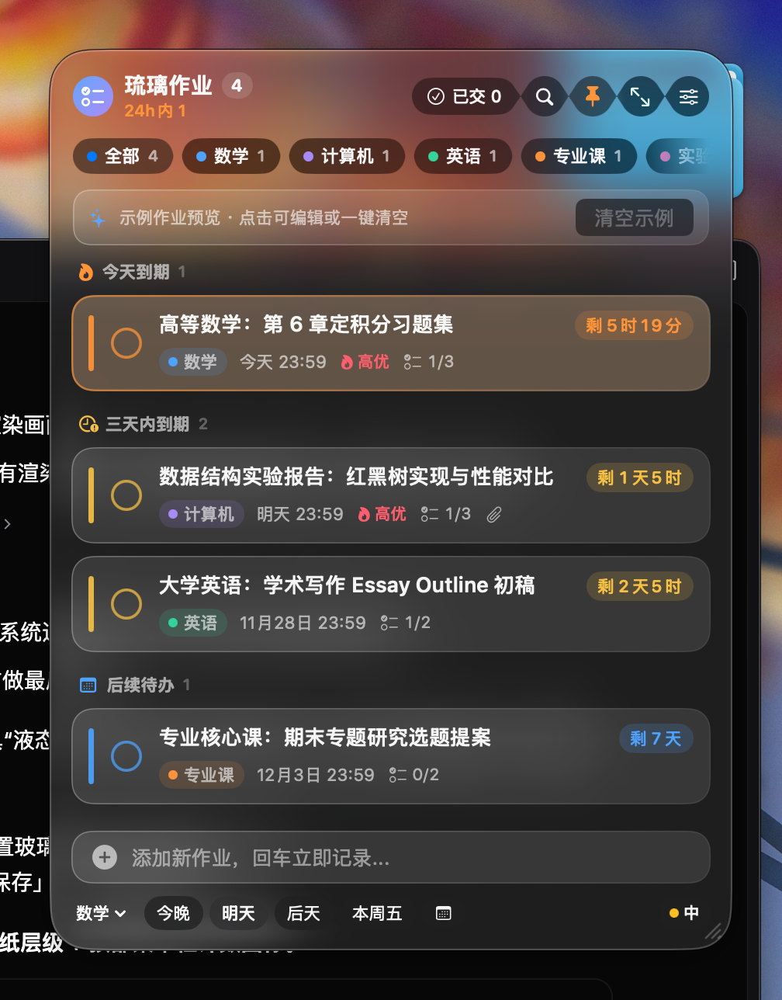
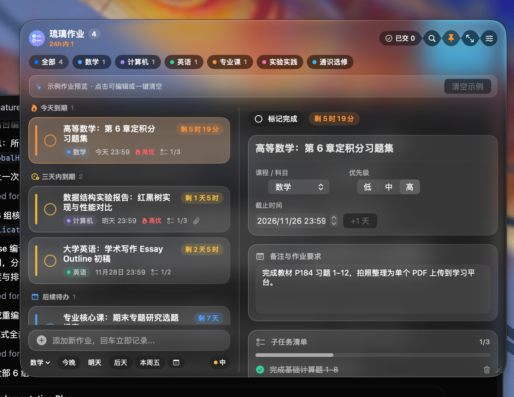
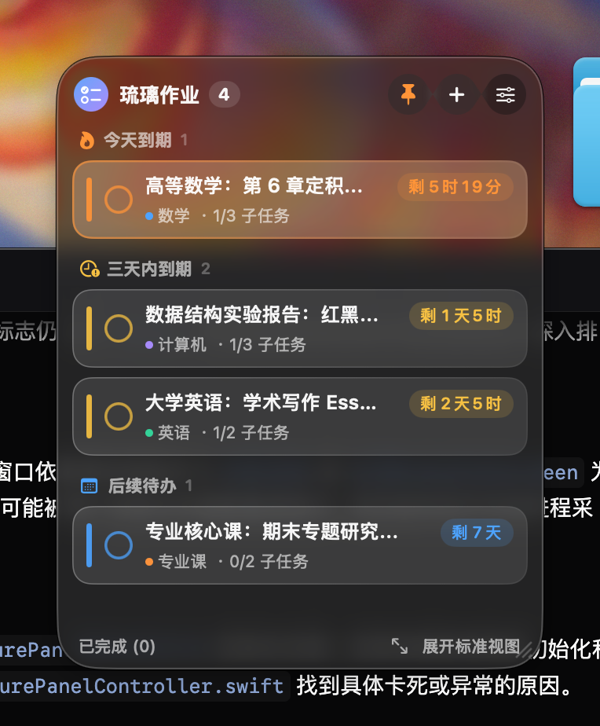
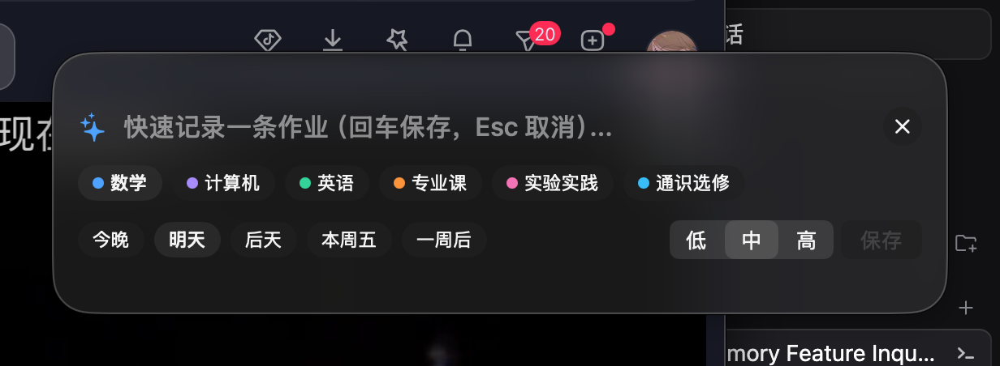

# 湘农作业（hunau_works）

<p align="center">
  
</p>

<p align="center">
  <strong>专为 macOS 26（Tahoe）打造的原生液态玻璃桌面作业提醒应用</strong><br/>
  基于 Swift 6 + SwiftUI + AppKit（<code>NSGlassEffectView</code> / <code>GlassEffectContainer</code> / <code>.glassEffect()</code>）构建
</p>

---

## 预览截图

| 标准桌面看板（440×580） | 宽屏双栏工作台（790×580） |
| :---: | :---: |
|  |  |

| 迷你贴纸模式（310×390） | 全局悬浮快记栏（`⌥ + Shift + H`） |
| :---: | :---: |
|  |  |

---

## 核心特性

- **macOS 26 原生液态玻璃（Liquid Glass）**
  - 外层窗口基于 AppKit `NSGlassEffectView` 实时折射桌面壁纸与高光边缘，支持切换 **清透折射（`.clear`）** 与 **标准液态（`.regular`）**、6 种色相微染、圆角调节与浅色/深色外观。
  - 顶部控制条与筛选胶囊使用 SwiftUI `GlassEffectContainer` 与 `.glassEffect()`，呈现自然流畅的玻璃融合与交互动效。
- **桌面常驻贴纸 & 一键置顶切换**
  - 默认停靠在壁纸与桌面图标上方（跨所有桌面空间显示，不遮挡正常办公窗口）。
  - 点击右上角图钉可随时切换 **桌面贴纸 ⇄ 始终置顶（Floating）**，并驻留顶部菜单栏实时显示未完成与逾期数量。
- **自由缩放三段式响应式布局**
  - **迷你贴纸（宽度 `< 350pt`）**：高密度紧凑卡片与倒计时。
  - **标准看板（`350pt – 659pt`）**：分组待办清单、科目胶囊筛选、底部快捷录入条与弹窗详情。
  - **宽屏工作台（`≥ 660pt`）**：左侧清单 + 右侧实时编辑面板（备注、子任务进度、提交链接与本地文件附件）。
- **视觉预警 + 系统通知双重提醒**
  - 实时倒计时与 4 级紧急色标（**已逾期 / 24h 内 / 3 天内 / 时间充裕**）。
  - 基于 `UNUserNotificationCenter` 的截止前本地通知（默认提前 1 天与 2 小时提醒，可自定义节点与免打扰静音）。
- **全键盘秒记 & 本地持久化备份**
  - 任意应用下按下 `⌥ + Shift + H`（无需辅助功能权限）呼出悬浮快记条，回车即存。
  - 数据本地保存于 `~/Library/Application Support/hunau_works/store.json`，支持设置内 JSON 导入导出备份与用户级 `LaunchAgent` 开机自启。

---

## 环境要求与构建安装

- **系统要求**：macOS 26.0 或更高版本（支持 Apple Silicon）
- **开发工具**：Swift 6.0+（仅需 Xcode Command Line Tools，无需完整 Xcode）

### 1. 运行核心单元测试

```bash
arch -arm64 swift run HunauWorksTestRunner
```

### 2. 编译打包并安装至 `/Applications/湘农作业.app`

```bash
./scripts/build_app.sh
```

脚本会自动编译 Apple Silicon Release 二进制、生成 `AppIcon.icns`、组装 `.app` Bundle、执行本地签名并安装到 `/Applications/湘农作业.app`。

---

## 目录结构

```text
hunau_works/
├── Package.swift                              # SwiftPM 工程定义（macOS 26+）
├── Sources/
│   ├── HunauWorksCore/                        # 数据模型、紧迫度计算、Store、持久化与提醒排期
│   └── HunauWorksApp/
│       ├── Resources/                         # 校徽图标资源 AppBadge.png
│       ├── HunauWorksAppMain.swift            # 应用入口与协调器
│       ├── Services/                          # 系统通知、Carbon 全局快捷键、开机自启
│       ├── Window/                            # NSGlassEffectView 桌面窗口、快记面板、菜单栏
│       └── Views/                             # 三段式 SwiftUI 液态玻璃界面与设置面板
├── Tests/HunauWorksCoreTests/                 # 原生自动化测试执行器
├── scripts/
│   ├── generate_icon.swift                    # 圆形校徽 AppIcon.icns 生成器
│   └── build_app.sh                           # Release 构建与 .app 打包安装脚本
└── docs/
    ├── ROADMAP.md                             # 未来多端与功能扩展构想（iPhone / EventKit / Windows）
    └── images/                                # 实机渲染预览截图
```

---

## 未来规划（已记录待定）

关于对接苹果「提醒事项（EventKit）」实现 iPhone 无痛联动、iOS 26（WidgetKit）移植以及 Windows 端方案的技术评估与构想，已整理在 [docs/ROADMAP.md](docs/ROADMAP.md)。
